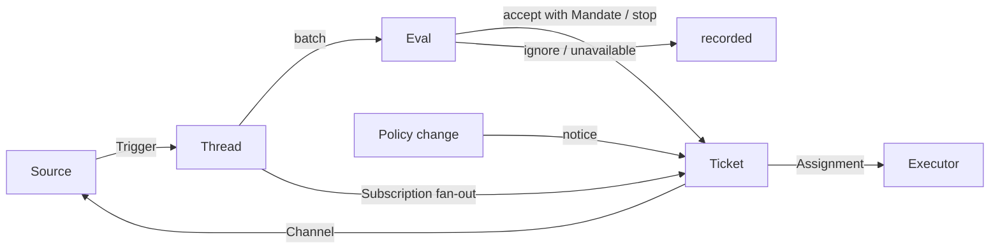

# 001 领域模型

本文档为 dsh-superagent 的各个概念命名，并说明每个概念遵守的规则。代码、agent 调用的工具、面板以及其他文档都使用这些术语，不使用别的术语。遵循 [000 理念](000-philosophy.md)，模型只包含工作所需的概念，一个业务需求会变成其中某个概念的属性。

## 流程

工作从 Trigger 流向 Eval，再流向执行。Source 产生 Trigger。Trigger 作为上下文扇出到订阅了其 Thread 的 Ticket。以这种方式送达某个 Ticket 的人的消息留在该 Ticket；其他所有 Trigger 进入 Eval，由 Eval 决定它是否在请求新工作。Eval 接受时，会创建一个带有 Mandate 的 Ticket。Assignment 把 Ticket 交给一个 Executor，结果通过 Channel 回到 Source。

## 概念

Source、Thread、Eval、Mandate 和 Subscription 构成核心领域；其余概念为它们提供支撑。

| 概念 | 定义 | 遵守的规则 | 存在的原因 |
| --- | --- | --- | --- |
| Source | 一个事件流。Source kind 是可复用的实现；Source 实例是某个 kind 的一份配置：是否运行、监听什么 | 保存自己的读取位置和自己的机器人身份。定义什么算一个事件，包括只有随时间推移才成立的条件。在进入领域之前，丢弃机器人自己的消息和不在监听范围内的 Trigger。把每个 Trigger 翻译成它所属的 Thread 和用于回复的 Channel 地址 | 重启时不能重放事件 |
| Trigger | 一个不可变的事件，带有 Source 自己的元数据，例如其行为者 | 属于一个或多个 Thread。同一个 Trigger 被接受两次只会创建一个 Ticket | 审计和幂等的单位 |
| Thread | 按时间排序的 Trigger；由 Source 定义哪些 Trigger 构成一个 Thread | 同一时间最多只有一个 Eval 在其上运行。它可以有多个 Ticket。它保存自己的 Subscription、正在运行的 Eval 和 Decision 历史 | 为 Eval 提供一致的视图和上下文 |
| Correlation | 同一个 Trigger 所属的多个 Thread 之间的关系 | 只增加上下文；从不路由 | 让 Eval 能追踪相关证据 |
| Channel | Thread 的写入端；由 Source 定义其地址 | 一个 Thread 可以有多个 Channel；一个 Ticket 持有一组 Channel | 确认、回复、pull request 和已解决的评审都是写入 |
| Policy | 带版本的评估规则，以及每个 Source 的部分：谁可以通过该 Source 发起工作（用该 Source 自己的身份表示）、名单如何同步，以及哪些机器人可以产生候选 | Policy 版本涵盖规则、接受模式和各 Source 部分。与某个活跃 Ticket 相关的变更（例如修改了它被接受时依据的规则）会送达其 Assignment；它不会撤销 Mandate。不同 Source 上的身份永远不会相互映射 | 规则变化时，正在运行的 Eval 必须被丢弃 |
| Eval | 对一批 Trigger 的判断，分两层：准入（gate）和研判（assessment） | 输入：Trigger 批次、Thread 快照、该 Thread 上的每个 Ticket（包括已结束的）以及当前 Policy。输出：一个 Decision。不保存状态 | 决定新工作是否开始、继续或停止 |
| Mandate | 一次接受所授予的内容：Policy 版本、范围、强度、匹配的规则、发送者在该 Source 上的身份，以及 Source 接收该 Trigger 的方式 | 不可变；更大的范围意味着新的 Ticket。Ticket 结束不会让它结束：只有人的停止会收回它，不再支持它的 Policy 会撤销它。在已结束的 Ticket 恢复之前，会按当前 Policy 重新验证 | 说明为什么可以做这项工作，以及可以做到什么程度 |
| Ticket | 一个已授权的工作单位 | 只有 Eval 能创建。引用其 Mandate；持有其 Channel 和 Input。状态从 open → ended，当某人在其某个 Thread 上的消息恢复它时回到 open，除非是人停止了它。自己定义状态，而不是跟随 Executor 的状态 | 拥有执行过程及其报告 |
| Assignment | Ticket 与一个 Executor 实例的绑定 | 一个 Ticket 随时间推移会有多个。独立于 Ticket 经历 pending → running → ended。在 Executor 一侧，只有它的最终报告可以结束 Ticket | Executor 在领域之外，但由谁执行必须在领域之内 |
| Subscription | Ticket 与 Thread 之间的多对多关系，由 Thread 持有 | 匹配的 Trigger 会扇出到每个活跃的订阅 Ticket，不检查发送者是谁；以这种方式送达 Ticket 的人的消息不经过 Eval。Executor 为获取上下文而跟随的 Thread 也以同样方式送达其 Ticket，但不给予它任何权限，也不会恢复它。已结束的 Ticket 保留其 Subscription，包括已关闭或已合并的 pull request 的 Subscription：人的消息会以同一 Mandate 恢复它，不经过 Eval 或 Decision；来自机器人和 CI 的消息不会送达它，因为其 Executor 在恢复时会重新读取它的 Thread。被人停止的 Ticket 不接收任何东西。主 Session 只有在消息明确指向某个已有 Ticket 时，才把一个 Thread 挂到该 Ticket 上。人可以删除一个 Thread 上的所有 Subscription；Executor 只能删除自己 Ticket 对某个它认为无关的 Thread 的 Subscription，但其 Ticket 起始的 Thread 和 Source 让它跟随的 Thread（例如它的 pull request）除外 | 之后的讨论无需有人再次 @ agent 就能送达 Executor |

人不是领域概念。Trigger 带有其行为者的标识符，形式与 Source 提供的一致。允许名单是 Source 在 Policy 中的部分，用该 Source 的身份表示。同一个人在多个 Source 上有账号这件事，是 agent 在需要时读取的提示词文本。

Executor（及其 Session 和目录）在领域之外，通过 Assignment 连接。

聚合：Source 持有其读取位置。Thread 持有其 Subscription、正在运行的 Eval（串行运行，并把期间到达的 Trigger 合并到下一批）以及 Decision 历史。Ticket 持有其 Assignment、Channel 和 Input，并按 id 引用 Decision。

## 被否决的概念

| 被否决的 | 原因 |
| --- | --- |
| 把 Principal 或 Membership 作为实体，或跨 Source 映射身份 | 人是 Trigger 的元数据；允许名单是 Source 在 Policy 中的部分；跨 Source 映射是提示词文本 |
| Eval 自己调度延迟的 Trigger | 需要等待的条件是一个普通的 Source，所以 Eval 永远不会反过来依赖 Source |
| 等待中或已撤销的 Eval 状态 | 等待属于 Source；超时的 Eval 会把其 Trigger 重新排队，或以 `unavailable` 结束 |
| 每个 Thread 最多一个活跃 Ticket | 一个 Thread 可以承载多项独立的工作；研判会根据 Ticket 列表避免重复 |
| "追加到 Ticket"这种 Decision | 追加就是 Subscription 扇出，不需要 Eval |
| 对 Subscription 做准入检查 | Subscription 覆盖整个 Thread；Mandate 把授权与上下文分开 |
| 会路由的 Correlation | Subscription 负责路由；Correlation 只增加上下文 |
| 跟随 DSH Session 的 Ticket 状态 | Ticket 可以被交接、恢复或由多个 Executor 运行，所以它自己定义状态 |
| Executor 声明有人要求它停止 | 只有 Eval 决定结束的强度 |
| Policy 变更时取消正在运行的 Ticket | 被取消的改动会留下做了一半的工作；改为记录变更并送达 |
| Executor Session 失败或受阻时锁定其所有工具 | 那会拒绝直接在 Session 中工作的人，以及恢复后的报告；暂停自动输入就够了 |
| 从报告的自由文本中推断"在等人" | 分类需要结构化的事实；Executor 通过一个结构化字段提问 |

## 可复用的部分

上述概念及其规则是可复用的。Source 实现、Policy 内容、Executor 和 Channel 实现属于某个部署。每个 Source 在内部保留自己的用词，例如 message、chat 或 notification，并把它们翻译成 Trigger。

| 部分 | 在本仓库中 |
| --- | --- |
| Source | 飞书：实时事件、历史恢复、对订阅话题的轮询。GitHub：通知、订阅的 Issue 和 pull request、CI 变化、已合并或已关闭的 pull request，以及在开启时仓库中的每个新 Issue、pull request、评论和默认分支的 CI |
| Policy | 研判规则，以及每个 Source 的允许名单、其同步、其机器人名单和其准入表 |
| Executor | 每个 Ticket 一个 DSH Executor Session 和一个目录，运行在一个执行环境中，其变量由 Executor 和各 Source 注册 |
| Channel | 飞书话题回复、GitHub 评论和评审线程回复 |

## 术语表

本文档及之后文档所用术语的参考列表，附中文名；之后的文档会解释上面未介绍的术语。面板一次只显示一种语言；它的 (?) 按钮会打开这份双语术语表。agent 在 GitHub 和飞书上发给人的消息使用平实的语言，而不是这些术语。

| 术语 | 中文 | 含义 |
| --- | --- | --- |
| Agent | 智能体 | dsh-superagent 运行的自动化团队成员，通过 GitHub 账号和飞书机器人等身份在 Source 上行动 |
| Main Session | 主 Session | 评估 Trigger、接受并分派 Ticket、并负责回复的 DSH Session；在代码和提示词中叫 `orchestrator` |
| Executor Session | 执行器 Session | Executor 为某个 Ticket 运行的 DSH Session；在代码和提示词中叫 `worker` |
| Source | 来源 | 一个事件流：由插件提供的一个 kind，加上一份实例配置 |
| Trigger | 触发 | 来自 Source 的一个不可变事件 |
| Thread | 线程 | 按时间排序的 Trigger；Eval 在其内一次只运行一个的单位 |
| Correlation | 关联 | 共享同一 Trigger 的 Thread 之间的关系；只增加上下文 |
| Channel | 渠道 | Thread 的写入端 |
| Policy | 策略 | 接受工作的带版本规则，以及每个 Source 在其中的部分，例如谁可以在那里请求工作 |
| Policy version | 策略版本 | 一种规则、Source 部分和接受模式组合的标识；每个 Mandate 都会记录它 |
| Eval | 评估 | 把一批 Trigger 变成一个 Decision 的过程 |
| Gate | 准入 | Eval 的确定性第一层：谁可以发起工作，以及以什么强度 |
| Assessment | 研判 | Eval 期间模型做出的判断 |
| Decision | 决定 | Eval 的结果 |
| Mandate | 授权 | 一次接受所授予的内容：强度、范围及其依据的 Policy 版本 |
| Ticket | 工单 | 一个已授权的工作单位 |
| Assignment | 派工 | Ticket 与一个 Executor 实例的绑定 |
| Subscription | 订阅 | Ticket 与 Thread 之间的关系 |
| Fan-out | 扇出 | 把订阅 Thread 上的 Trigger 作为上下文送达 Ticket |
| Executor | 执行器 | 运行 Assignment 的端口：每个 Ticket 一个 Executor Session 和一个目录 |
| Execution environment | 执行环境 | Executor Session 和准备命令运行的地方：由 Executor 和各 Source 注册的变量，每个都有 key、value 和描述 |
| Report | 报告 | Assignment 向其 Ticket 报告的状态 |
| Attention | 待人工决定 | Ticket 上一个等待人回答的问题 |
| Disposition | 去向 | 一个 Trigger 被过滤、评估或扇出的记录 |
| Input | 输入 | 送达 Ticket 的上下文：扇出的 Trigger、Policy 变更、恢复和文本 |
| Scope | 范围 | Mandate 允许的工作 |
| Strength | 强度 | Mandate 或 Eval 的依据有多强 |

| 组 | 取值 |
| --- | --- |
| Decision | accept 接单 · stop 停止 · ignore 忽略 · unavailable 未完成 |
| Strength | explicit 明确 · inferred 推断 |
| Assignment | pending 待启动 · running 执行中 · ended 已结束 |
| Report | progress 进展 · waiting 等待 · ready 就绪 · blocked 受阻 · failed 失败 · dropped 无需处理 |
