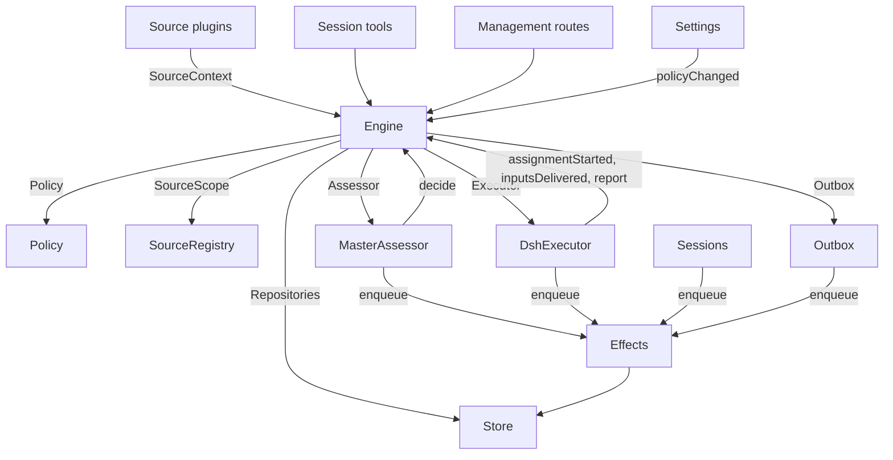

# 007 架构

这是面向开发者的实现指南。它把 [001 领域模型](001-domain.md) 到 [006 部署](006-deployment.md) 中的概念映射到类、接口和文件上。从运行时（Runtime）和 Engine 开始读，然后把模块表和测试表当作代码索引来用。

## 核心类与胶水代码

核心类把领域概念和外部边界放在小接口后面。胶水代码把工具参数、HTTP 请求、Source 载荷和 DeepSeek Harness 事件翻译成对这些类的调用，再把结果变成卡片、视图和消息。

`Runtime`（`src/app/runtime.ts`）构造应用、提供依赖，并负责启动和关闭。`Engine` 自己构造其内部部件。Executor 和 Assessor 会回调 Engine，所以 Runtime 给它们传 getter，而不是要求按循环依赖的顺序构造。

### Runtime

`Runtime` 是组合根；它不包含任何领域规则。它的构造函数锁定状态目录、打开 Store 并构建每个组件。如果构造失败，它会关闭 Store 并释放锁。

启动时注册管理路由并运行 Setup。Setup 解析完成后，它安装 Session 和 Executor 的钩子，确保主 Session 存在，启动 Policy 同步，恢复被中断的 Assignment，并启动 passes 和 effects。`ready` 标志启动完成。

关闭时取消正在进行的轮次，等待 passes、effects 和 agent，恢复进程环境，关闭 Store 并释放锁。Source 插件通过窄接口 `SourceHost`，把 Runtime 作为 `orchestrator` 服务注入。

| 部件 | 模块 | 作用 |
| --- | --- | --- |
| Setup | `src/app/setup.ts` | 以 worker shell 运行 CLI 的方式探测它们，从而解析仓库和账号；写入并应用 worker 的环境和命令垫片，并保存设置问题；Settings 通过它检查修改过的账号，并通过它重启（这会再次运行设置检查） |
| Passes | `src/app/passes.ts` | 一次只运行一个 pass，每两秒一次，或在某个命令请求时运行：先执行到期的 effects，再执行 `Engine.evaluateDue`；Source 的 Trigger 经由它到达 Engine |
| Outbox | `src/app/outbox.ts` | Engine 的 `Outbox` 端口，也是 receipt 的唯一写入者：`send` 在一个事务中保存消息的 receipt 并排入其 `reply` effect，该 effect 的处理器通过 `SourceRegistry.send` 发送它；当其 Source 关闭时消息会等待，当对话已不存在或不再被监听时消息会被丢弃 |
| Notices | `src/app/notices.ts` | 把领域事件和 worker 活动转换成发给主 Session 的消息。`eventNotice` 处理领域通知；`reportRelay` 立即转发问题，把普通进度留在其 Ticket 上，并转发其他报告；`followupRelay` 列出拥有某条人类后续消息的 Ticket。在一轮进行中到达的转发，会在下一步通过 DeepSeek Harness 收件箱一起送达 |

### Engine

`Engine`（`src/core/engine.ts`）是 Trigger、Thread、Decision、Ticket 和 Assignment 的唯一写入者。它从 `src/core/ports.ts` 接收这些端口：`Repositories`、一个获取当前 Policy 的 getter、`SourceScope`、`Assessor`、`Executor` 和 `Outbox`。可选依赖是 `prepareTicket`、`now` 和 `emit`。

Engine 的所有方法都是同步的。每个命令在一个事务中修改其聚合。`evaluateDue` 对它修改的每个 Eval 或 Ticket 使用单独的事务。端口在事务内把外部工作排队；适配器在提交之后执行它。无效的请求抛出 `UserError`。

Engine 暴露一个入口，并委托给五个内部部件。它拥有每个命令的事务。跨部件的命令，例如 `attach`、`evaluateDue` 和 `policyChanged`，会依次调用各部件。

每个部件都继承 `EnginePart`（`src/core/part.ts`），它提供选项和共享的读取。部件之间的依赖是单向的：

| 部件 | 职责 | 依赖 |
| --- | --- | --- |
| `Intake` | Source 的 Trigger：连同其去向只存储一次，记录在其 Thread 及其关联上，扇出到订阅的 Ticket，并且除非它是送达了某个 Ticket 的人的消息，否则在其主 Thread 上排队等待 Eval | Tickets |
| `Evals` | Thread 的 Eval：分批、准入给出的强度、行为者和依据及给出它们的 Trigger（`primary`）、从候选送达开始计算的截止时间及其因暂停的顺延、过期 Eval 的重新排队、候选、重放和退回、Policy 变更时的重新排队，以及每个 Eval 最终的 Decision：accept、stop、ignore 或 unavailable | Tickets |
| `Tickets` | Ticket 生命周期：由 accept 创建（连同其 Mandate、Subscription 和第一个 Assignment）、它跟随的 Thread 及其关闭（`followsDone`）、被挂上的 Thread 和为上下文而跟随的 Thread、Input 和备注、恢复以及恢复所拒绝的消息、重试、重启、停止和结束、它删除的 Subscription，以及对受 Policy 变更影响的 Ticket 的通知 | Replies |
| `Assignments` | Executor 及其 worker 报告的内容：Assignment 已启动、Input 已送达或送达失败、重启中断了它，以及 worker 的 Report 及其给人的问题 | Tickets, Replies |
| `Replies` | 通过 `Outbox` 的 Channel 写入：确认、回答、结果和 attention 消息，各自遵循允许它的规则 | 无 |

命令使用祈使式的名称，例如 `stopTicket`；适配器报告的事实使用过去式名称，例如 `assignmentStarted`。查询 `candidate` 使用名词。

调用方只拿到 Engine 中与其角色对应的 `Pick`：`EngineForSources`、`EngineForMainSession`、`EngineForPeople`、`EngineForSettings` 或 `EngineForExecutor`。

| 角色 | 方法 | 效果 |
| --- | --- | --- |
| Sources | `receive(trigger)` | 只存储一次 Trigger，回答 `stored`、`duplicate`，或当没有 Source 接收它时回答 `filtered`；把它扇出到订阅了其 Thread 的 Ticket（除非处理被暂停，人的消息会立即恢复已结束的 Ticket），并在其主 Thread 上排队等待 Eval，除非它是送达了某个 Ticket 的人的消息，那样它就留在该 Ticket |
| Sources | `bindThread(ticketId, thread, own)` | 让一个未结束的 Ticket 跟随该 Source 的某个 Thread，例如一个 pull request 的 Thread；当 Ticket 开出了它时为 `own`；已关闭的 Thread 被再次绑定时会重新打开。结束 Ticket 的是这些 Thread 的关闭，而不是 `ready` Report |
| Sources | `threadClosed(thread, outcome, at)` | 一个 Thread 关闭了：跟随它的每个未结束 Ticket 记录这次关闭，并在它跟随的 Thread 都处理完（`followsDone`）时结束：它开出的 Thread 都不再打开，或者当它一个都没开时，它跟随的每个 Thread 都已关闭。它以那些关闭中最后一次的结果结束为 `merged` 或 `closed`，除非关闭后恢复的工作还没报告 `ready`，或者其 Executor 通过确认或回答，接手了一条它在最近一次非 `progress` Report 或最后一轮结束之后决定的人类后续消息；此时一个 `dropped` Report 会以那次关闭的结果结束它 |
| Main Session | `candidate(triggerId)` | 持有某个 Trigger 的 Eval，以其研判者看到的样子 |
| Main Session | `candidateDelivered(evalId)` | 该 Eval 的候选已到达主 Session：其截止时间从现在开始计算 |
| Main Session | `decide(triggerId, outcome)` | 记录一个 Eval Decision，或对显式请求记录一个直接 Decision。accept 会原子性地创建 Ticket、Mandate、Assignment、Subscription 和确认。根据卡片忽略的推断候选，会在给出的理由之前记录 `ignoredFromCard`。当 `followupOwners` 仍拥有一条人类后续消息时，只允许 stop |
| Main Session | `attach(ticketId, triggerId, note?)` | 把一个 Trigger 路由到它所指向的 Ticket，由其 Executor 把它作为后续消息来决定，并结束持有它的 Eval，该 Eval 的其他 Trigger 等待新的 Eval；除非处理被暂停，已结束的 Ticket 会立即在其 Mandate 下恢复。仍由某个 Executor 决定的后续消息会被拒绝，被路由回退回它的那个 Ticket 的也会被拒绝 |
| Main Session | `requestStatus(ticketId)` | 向一个等待中的 Executor Session 询问其状态，并回答是否问了 |
| Main Session | `note(ticketId, text)` | 以文本 Input 的形式，把来自其他工作的一个事实交给某个 Ticket 的 Executor，它不授予任何东西 |
| Main Session, Executor | `reply(request)` | 为其 purpose 指定的 Channel 排入一条消息：`acknowledgement`、`answer`、`result` 或 `attention` |
| People | `stopTicket(ticketId, reason?)` | 人的停止，会收回 Mandate |
| People | `retryTicket(ticketId)` | 结束一个 Ticket 停滞的 Assignment 并开始一个新的；适用于在 `failed` 或 `blocked` Report 后等待人、或 Input 送达失败（`canRetry`）的 Ticket |
| People | `reevaluate(triggerId)` | 把一个已存储的 Trigger 排队重新 Eval |
| People | `unsubscribe(thread)` | 删除一个 Thread 上的所有 Subscription，跟随它的 Ticket 不再跟随它；每个 Ticket 继续决定它在那里收到的后续消息 |
| People | `dismiss(decisionId)` | 忽略一个 `unavailable` Decision 显示的问题，Decision 会记录这一点 |
| Executor | `assignmentStarted(ticketId, assignmentId)` | 一个 Assignment 开始运行；其等待中的 Input 被发出 |
| Executor | `inputsDelivered(ticketId, assignmentId, inputIds)` | Input 已到达该 Assignment 的 Executor Session，每条在那里等待某一步来接收它 |
| Executor | `inputsRead(ticketId, inputIds)` | Executor Session 把承载这些 Input 的消息纳入了其历史（一个 `user/message` Session 事件），其模型从那里拿到它们；一个认领了它们、但在此之前被取消或失败的步骤不算。之后一旦有 Report 或一轮结束，每条都算作已读，重启之后也是如此，其 Ticket 的结束也不会放弃它；在开始记录读取之前送达的 Input，在其送达之后有 Report 或一轮结束时算作已读 |
| Executor | `turnEnded(ticketId, assignmentId)` | Executor Session 的一轮结束了（Report 之后也算），前提是没有东西在后台为它运行，或者它正在交接给人。一个步骤之前接收的内容，它都已读（`inputsRead`） |
| Executor | `deliveryFailed(ticketId, assignmentId, error)` | 送达 Input 失败；Ticket 会显示这一点，直到一次送达成功、一个新的 Assignment 开始或 Ticket 结束 |
| Executor | `report(ticketId, report)` | 记录一个 Report 及其给人的问题；`dropped` 结束 Ticket，`ready` 会完成一个不跟随任何 Thread 的 Ticket，并按其跟随的 Thread 的结束情况结束一个已处理完它们的 Ticket |
| Executor | `markUnrelated(ticketId, thread, reason)` | 只删除该 Ticket 对一个它认为无关的被挂上的 Thread 的 Subscription，并连同理由退回该 Ticket 在那里决定的后续消息 |
| Executor | `followForContext(ticketId, thread)` | 让一个未结束的 Ticket 为获取上下文而订阅一个相关的 Thread：其消息会送达 Ticket，但不给予它 follow-up 强度，也不会恢复它 |
| Executor | `handback(ticketId, triggerId, reason)` | 记录该 Ticket 退回一个送达它的 Trigger，附上其候选会携带的理由；如果该 Ticket 决定过它，则在没有其他 Ticket 决定它时把它排队重新 Eval；回答是否排了队。一个 Ticket 对每个 Trigger 只退回一次，并保留其 Subscription |
| Executor | `assignmentInterrupted(ticketId, assignmentId)` | 宿主停止时某个 Assignment 正在运行：工作中途被中断的，或在最近一次 Report 之后收到过 Input 的，会像重试一样，带着一条恢复说明以及送达它但其 Executor Session 未接收的 Input 重新开始；之后已经报告过的则保留其 Session。DshExecutor 在启动时（`resume`）逐个报告它们，最早的 Ticket 优先，并把等待中的启动重新排队 |
| Passes | `evaluateDue()` | 除非处理被暂停：为排队 Trigger 正在等待的 Thread 启动 Eval，每个 Thread 一个，期间排入的 Trigger 合为一批；把超过截止时间的 Eval 的 Trigger 重新排队，连续两次，第三次时记录为 `unavailable`；并恢复在暂停期间被人的消息送达的已结束 Ticket，前提是它们的 Mandate 仍然成立。候选尚未到达主 Session 的 Eval 不会过期。处理暂停期间，没有 Eval 会过期，恢复后每个截止时间都会顺延暂停的时长 |
| Settings | `policyChanged(from, to, effects)` | 告诉受变更影响的每个活跃 Ticket 它是如何受影响的（`src/policy.ts` 中的 `policyEffects`：它被接受时依据的规则变了或不再适用、其请求者不能再发起工作，或不再接受主动工作），并在新版本下重新启动进行中的 Eval |

Engine 把分批、授权、扇出、恢复和 attention 生命周期的规则保持为私有。几个共享的谓词让这些规则保持一致：

- `waitsForPerson`（`src/core/model.ts`）：最新的 Assignment 报告了 `blocked` 或 `failed`，并且此后没有人类消息到达。只要它为真，自动 Input 和失败的启动就保持暂停。
- `followupOwners`：仍对在其自己 Thread 上收到的某条人类后续消息负责的 Ticket。Ticket 可以是活跃的，或者已结束但不是被人停止、并在等待恢复。退回该消息会结束这种所有权。
- `settled`：某个 Decision 已解决了该请求；stop、unavailable、routed 和被拒绝的 stop Decision 不算。
- `ticketStage`（`src/core/stage.ts`）：实现 [003 执行](003-execution.md) 中的阶段表。

当 Ticket 结束时，未读的后续消息会回到 Eval，除非另一个 Ticket 仍拥有它们，或另一个去向已经解决了它们。已确认、已回答和已退回的消息会被排除。对于没有确认去向的旧记录，由 outbox receipt 提供这一事实。最终 Report 也覆盖 Assignment 开始时就在等待的消息，包括恢复它的那条消息。停止某个 Ticket 的消息不会被自动重新评估。

发生变更后，Engine 会从 `src/core/ports.ts` 中的 `DomainEvents` 发出一个事件：

`trigger.received`、`eval.started`、`decision.recorded`、`ticket.created`、`ticket.resumed`、`ticket.ended`、`assignment.started`、`assignment.ended`、`thread.subscribed`、`thread.unsubscribed`、`trigger.requeued` 或 `policy.changed`。

Runtime 把 `ticket.ended`、`trigger.requeued` 和 `thread.unsubscribed` 变成通知。送达 Ticket 的人类 `trigger.received` 会变成一次 follow-up 转发。当 Ticket 以 merged 或 closed 结束时，`pullEndNotices` 使用一个稳定的 id 发送一条聊天通知。其他事件目前没有消费者。

### 模型

`src/core/model.ts` 保存领域类型，`src/core/stage.ts` 保存 Ticket 阶段。Decision 把原因记录为 `reason`，即一个 `Reason` 列表（`src/core/reasons.ts`）：每个是一个 `code` 及其 `values`，对于批次中的单个 Trigger，还有其 `triggerId`。

核心的代码，例如 `timeout`、`policyChanged`、`routed` 和 `startedTicket`，属于 `REASONS`，附有 agent 通过 `reasonText` 读取的英文；准入或 Source scope 会给出自己的代码，例如 `not_a_member`；`said` 承载研判者或人写下的话。面板按 `reason.<code>` 为每个代码措辞，被 Source 过滤的 Trigger 也以同样的方式记录 Source 的代码。

Ticket 对每个事实只保存一次。没有 `ended` 时它就是未结束的，`ended` 记录它何时、由谁、为何以及以什么结果结束；它最后说的话是其最新 Assignment 的 Report（`latestReport`）；其 Executor Session 以它命名（`src/executor/dsh.ts` 中的 `workerSessionId`）。

它的字段是类型化的：`origin`，即给其 Eval 批次提供强度的可准入 Trigger 以及该批次本身（`triggerId`、`triggerIds`）；`execution`，即 Executor 选择的内容（`name`、`directory` 和 `assignment`）；`delivery`，即最后一次失败的 Input 送达（`error`、`at`），直到一次送达成功、一个新的 Assignment 开始或 Ticket 结束；以及 `follows`，即 Source 让它跟随的 Thread，每个为 `{thread, own, closed?}`：当 Ticket 开出了它时为 `own`，关闭后带有 `at` 和 `outcome` 的 `closed`。只有 Tickets 写入 `follows`；GitHub Source 用 `pullsOf` 和 `pullOf`（`src/sources/github-pull.ts`）读取其 pull request。

承载 Trigger 的 Input 会记录是否由人写成，`waitsForPerson` 会读取这一点。Thread 还在 `context` 中列出仅为上下文而跟随它的订阅 Ticket，并在 `expired` 中统计其排队 Trigger 的 Eval 连续过期的次数；Evaluation 记录其 `primary` Trigger 以及其候选何时 `delivered`。

Trigger 的去向记录了它送达的 Ticket（通过扇出或挂接）、人的重新排队、每个退回它的 Ticket 及其理由，以及每个其 Executor 确认或回答了它的 Ticket。

Mandate 的 `basis`（`MandateBasis`）记录准入是如何接纳其 Trigger 的。重新验证会读取接收的 `source`、`scope` 和 `row`、名单上的 `sender`、匹配的 `rules`，以及 `via`：

| `via` | 准入依据 |
| --- | --- |
| `addressed` | 一个允许的发送者对 agent 说话 |
| `followup` | 一条消息到达了一个有 Ticket 的 Thread |
| `admission` | 一个准入表单元格；`observation` 标记一个推断候选 |
| `bot` | 一个列出的机器人产生了一个推断候选 |

Trigger 和 Thread 的 `meta` 属于 Source。核心不解释它们。

### Policy

`src/policy.ts` 定义设置的 schema、授权和研判规则。`settingsPolicy(settings, scope)` 每次使用时都返回一个新的、无状态的 `Policy`：

- `version`、`paused` 和 `evalTimeoutMs` 描述其当前状态。
- `gate(trigger, thread, tickets)` 返回准入强度和依据。
- `revalidate(mandate)` 检查一个已有的 Mandate 是否仍然成立。
- `admitsInferred(rules)` 只在 auto 模式且有已启用的匹配规则时允许主动接受。

`assessmentOutcome(assessment, settings, strength)` 把模型的研判转换成 Engine 的结果。它要求对每条已启用规则都有一个判断、方向已确定、有一条匹配的规则，以及意图的证据。在 auto 模式之外，推断的 accept 会变成一条"本会接受"的记录。

`policyEffects(tickets, old, now, scope)` 识别一次变更影响了哪些未结束的 Ticket，以及如何影响。`Engine.policyChanged` 只通知这些 Ticket。`policyVersion` 对规则、接受模式和各 Source 的 Policy 部分（包括机器人名单）做哈希。

### Store

`Store`（`src/app/store.ts`）拥有一个 SQLite 数据库。Runtime 在打开它之前获取目录锁，防止第二个进程迁移或写入同一份状态。

它的接口按用途分组：

- **领域仓库：** `atomic`，以及 `triggers`、`threads`、`tickets` 和 `decisions`，每个都有 `get`、`save` 和列表查询。带索引的工作集是 `threads.active()`、`tickets.open()`、`tickets.active()` 和 `read.subscribedThreads`。
- **读取查询：** `read` 通过 `threadTriggers`、`triggerStats`、`search` 和 `droppedReplies` 等方法为视图、工具和 Source 轮询提供服务。这些方法从不写入。
- **Source 元数据：** `threads.describe` 和 `threads.patchMeta` 更新 Source 拥有的 Thread 元数据。
- **设置：** `settings`、`saveSettings`、`blockRevision` 和 `settingsHistory`。设置和提示词使用带编号的 `Versions`（`src/app/versions.ts`）。
- **Outbox receipt：** `replyStatus` 和 `receipts`，只由 Outbox 写入。receipt 操作有 `get`、`waiting`、`behind`、`add`、`settle` 和 `withdraw`。`behind` 检查同一 Ticket 和对话中是否有一条更早的消息正在等待且失败次数少于三次。被撤回的消息以 `channelGone` 或 `channelIgnored` 结算。读取查询通过 `failingReplies`、`droppedReplies` 和 `droppedSince` 暴露失败和被丢弃的回复。
- **类型化的键值记录：** `get`、`set`、`delete` 和 `keys`，使用 `KV` 中的条目。

`afterCommit` 只在事务提交之后运行一个操作，回滚之后从不运行。Runtime 以存储时的形状读取记录；schema 11 迁移会在启动时转换较旧的受支持记录。

### Effects

`Effects`（`src/app/effects.ts`）是持久化的副作用队列。命令在其事务内调用 `enqueue(kind, key, payload)`；执行只在提交之后开始。

每个 kind/key 对只有一行。对同一个等待中的 key 再次入队，会替换其载荷并使其立即到期，而不改变队列顺序。`handle(kind, run, options)` 为每个 kind 注册一个处理器。它按最早优先处理到期的行，最多到并发上限。

失败按指数退避重试。抛出 `Later` 会推迟工作而不计为一次失败，例如在没有可用 worker 槽位时。`start` 在设置检查之后开始处理，`drain` 在关闭时停止处理并保留待处理的行，`pending`/`idle` 暴露队列状态。

| Kind | 处理器 | 作用 | 同时数量 | 重试 |
| --- | --- | --- | --- | --- |
| `assessment` | MasterAssessor | 把一个 Eval 的候选卡片引导进主 Session 的当前轮次，然后告诉 Engine 它已送达，这会开始 Eval 的截止时间计时 | 4，暂停时为 0 | 2 秒起逐次翻倍到 60 秒 |
| `launch` | DshExecutor | 启动一个 pending 的 Assignment：准备命令、Executor Session、分派消息 | 空闲 worker 槽位数，暂停时为 0 | 模型提供方或网络的暂时性故障在 5 秒后重新运行，逐次翻倍到 300 秒，共三次；其他任何失败，以及失败的准备命令，都会使其 Ticket 失败。被暂停或 worker 槽位已满挡住的，5 秒后再试 |
| `delivery` | DshExecutor | 把一个 Ticket 等待中的 Input 按顺序交给其正在运行的 Assignment | 4，暂停时为 0 | 2 秒起逐次翻倍到 60 秒；等待 worker 槽位的，2 秒后再试 |
| `relay` | Sessions | 把 worker 的报告或问题、或人的后续消息，引导进主 Session 的当前轮次 | 1，按队列顺序 | 2 秒起逐次翻倍到 60 秒 |
| `notice` | Sessions | 把一条通知注入主 Session 而不唤醒它 | 1，按队列顺序 | 2 秒起逐次翻倍到 60 秒 |
| `reply` | Outbox | 通过其 Source 为某个 Channel 发送一条消息，前提是其 Ticket 发往该对话的、未失败三次的更早消息都已发出；撤回该消息会取消它 | 1，暂停时为 0 | 5 秒起逐次翻倍到 300 秒；其 Source 关闭或排在更早消息之后的，5 秒后再试 |

每个 kind 都有一个以其名称命名的健康条目。一旦它的某个 effect 连续失败三次，它就报告一个错误，但 `delivery` 除外，它的失败改为显示在对应的 Ticket 上。relay 保持顺序，notice 也是；失败的一条会挡住同类之后的条目。

### Sources

Source 通过 `src/sources/kind.ts` 中定义的 `SourceKind` 扩展宿主。一个 kind 声明其身份、标题、描述、配置 `schema` 和 `fields`、推导出的 `facts`，以及 `health` 条目。可选行为包括 `scope`、一个 `channel`（`allowed`、`send`、`link`）、`threadContext`、`find`、`policy`、`environment` 和 `refreshLabels`。

`SourceRegistry`（`registry.ts`）拥有已注册的 kind 和已存储的实例，并实现 Engine 的 `SourceScope`。注册时会在 `HealthBoard` 上认领健康条目；重复认领和保留的 `sync:` 名称会被拒绝。SourceContext 只通过其注册认领的条目写入，所以注销之后的报告不起作用。

注册表的配置方法包括 `kind`、`instances`、`instance`、`validate`、`validatePolicy`、`policyPart`、`channelAllowed`、`declarations`、`environments`、`find` 和 `scope`。`find` 会询问每个支持搜索的 kind。

通用代码通过注册表访问 Source 的行为。`send(message, commands)` 调用 kind 的 Channel，返回 `sent`、`gone`，或在 kind 未安装时返回 `waiting`。`link` 解析其 Channel 链接。`threadContext` 把 kind 的读取器与其配置配对，当 kind 没有读取器时什么都不返回。无效的已存储配置会禁用该实例。

插件拿到 `SourceHost`：注册表和 `context(kind)`。kind 本身使用一个更窄的 `SourceContext`，由 `src/app/source-context.ts` 中的 `sourceContextOf` 构建。

该上下文提供部署和命令、设置就绪状态（`ready`、`configured`、`problem`）、配置、`receive`、`atomic` 和类型化的 `state`。它还暴露 Thread 读取和元数据写入、Ticket 读取和绑定/关闭命令、Trigger 读取、通过 Outbox 的 `notify`，以及用于已声明健康条目的 `report`。

### DshExecutor

`DshExecutor`（`src/executor/dsh.ts`）为每个 Ticket 提供一个 Session 和一个目录。`start` 和 `deliver` 把 `launch` 和 `delivery` effect 入队。`stop` 通过 `Store.afterCommit` 取消当前轮次，所以被回滚的结束不会停止 worker。

`prepare(ticket, outcome)` 提供 Engine 的 `prepareTicket` 钩子：短名称、目录和 `ticketExecution` 分派文本。`workerSessionId(ticket.id)` 推导出 Session id。

`WorkerSlots` 在一次启动或一次唤醒空闲 worker 的送达之前预留容量。人类消息可以使用一个超出 `maxWorkers` 的槽位，且唤醒优先于启动。`activeCount` 提供面板上的负载。

暂时性的提供方和网络故障有三次重试。启动使用 effect 的退避；失败的轮次会在 15、30 和 60 秒后收到继续消息。`inputMessage` 根据当前 Ticket 状态渲染每条 Input，`mandateInstructions` 为推断的工作添加匹配规则的限制。

`install` 订阅 Session 事件；`dispose` 取消订阅。一轮结束通常报告等待，但在就绪之后或需要人采取行动时除外。错误报告为失败。启动时，`resume` 通过 `assignmentInterrupted` 报告被中断的 Assignment，并把不等待人的 pending 启动重新排队，最早的 Ticket 优先。

### MasterAssessor

`MasterAssessor`（`src/app/assessment.ts`）让主 Session 研判主动候选。`request` 排入一个 assessment effect；`release` 在其 Eval 结束时丢弃缓存的状态。

它的 `context`、`read` 和 `decide` 方法为 `orchestrator_eval`、`orchestrator_eval_read` 和 `orchestrator_eval_decide` 提供服务。它们通过 `SourceRegistry.threadContext` 提供有界的 Thread 上下文、仓库上下文和决定提交。没有上下文读取器的 kind 只提供 Trigger 和批次。

`assessmentOutcome` 为 `Engine.decide` 转换模型的回答。Evals 会再次按当前 Policy 检查推断的接受。

### Settings

`Settings`（`src/app/settings.ts`）读写带修订号的设置区块。`current` 和 `view` 读取它们；`save(block, value, revision, origin)` 校验一次保存；`pause(paused, origin)` 修改单独的 `paused` 设置。

每次保存都声明其来源：`panel`、`tool` 或 `sync`。只有 `panel` 能修改执行环境或 `SETUP_FIELDS`（`src/deployment.ts`）中列出的字段。

Policy 版本变更会计算 `policyEffects`，记录哪些 Ticket 被通知，并调用 `Engine.policyChanged`。`syncable` 和 `sync(id)` 刷新某个 Source 的 Policy 部分。`refreshLabels(id)` 刷新显示名称。

### Prompts

`Prompts`（`src/app/prompts.ts`）把配置存储为 `Versions`。`current`、`version` 和 `history` 读取它们；`validate`、`preview` 和 `save(value, baseRevision, source)` 检查并保存它们。`compose` 和 `skills` 构建 Session 文本。

`builtInParts` 列出覆盖的 key、角色、默认文本和必需的模板占位符。每个覆盖存储团队的 `text` 和一个 `base`：其原始默认值的 `builtInBase` key。保存时会在 `KV.prompts.builtIn` 下保留那个默认值。然后 `defaultChanged` 会报告变化了的默认值、可用时它们的旧文本，以及被移除的部分。

校验会从已保存的覆盖继承被省略的 base，丢弃已保存数据中已存在的被移除部分，并拒绝空白文本或其他未知 key。这让保存工具可以把它读到的配置原样写回。`environmentSection` 和 `policySection` 只用自有 key 替换一次模板值。没有覆盖的配置使用默认值。

### Sessions

`Sessions`（`src/app/sessions.ts`）为两种角色管理 DeepSeek Harness Session。`ensure` 用其角色的模型创建一个 Session。`install` 跟随 agent 事件，并为受管理的 Session 注册提示词、skill 和工具。

`prompt` 对每个请求 id 只送达一次。`relay` 和 `notify` 把主 Session 的消息入队，由 `relay` 和 `notice` effect 处理。`src/app/notices.ts` 定义它们的内容；`delivery` 检查一条消息是否已到达。

每次模型请求都会把 Session 绑定到当前的提示词修订。它用过的修订会被持久存储：`promptVersion` 标识当前的那个，`mayRead` 限制 worker 可以查看哪些版本。注册信息按 agent 记录在一个 map 中。

`status` 和 `promptVersion` 为提示词页面提供服务。保存经由 `Prompts.save` 并通知主 Session。`modelRetry` 暴露模型预算重试的状态。

### 胶水代码

| 胶水代码 | 翻译 |
| --- | --- |
| `src/app/runtime.ts` | 组合根：用各部件使用的接口构建它们，注册路由和 Source 宿主，并启动和停止 dsh-superagent |
| `src/app/notices.ts` | 把领域事件和 worker 报告变成给主 Session 的通知和转发 |
| `src/app/tools/main.ts`、`src/app/tools/executor.ts` | 把主 Session 和 Executor Session 的工具参数变成对核心类的调用，并把结果变成卡片 |
| `src/app/http.ts`、`src/app/views/`、`src/app/api.ts` | 把 HTTP 请求变成调用，把 Store 读取变成面板的视图；`api.ts` 为面板给每个路由定义类型 |
| `src/app/resources.ts`、`src/app/links.ts`、`src/app/cards.ts` | 把资源名称变成读取，把来源消息变成链接，把记录变成给模型用的紧凑卡片 |
| `src/sources/github*.ts`、`src/sources/feishu*.ts`、`src/sources/poll.ts` | 把 GitHub 和飞书的载荷变成 Trigger 和 Thread 事实，把消息变成 CLI 调用 |
| `src/deployment.ts`、`src/setup.ts`、`src/infra/` | 设置检查的探测和问题、CLI 传输、agent 的进程环境 |

## 依赖规则

- **显式、窄的依赖。** 每个类接收一个指明它使用了什么的接口，大多是其他类的 `Pick` 类型：核心类有 `ExecutorHost`、`AssessorHost`、`SessionsHost`、`SettingsHost`、`SetupHost`、`PassesHost` 和 `OutboxHost`，胶水代码有 `HttpHost`、`MainToolsHost`、`ExecutorToolsHost`、`ResourceHost`、`LinkHost` 和 `SourceContextDeps`，Engine 则以调用它的角色的 `Pick` 出现。Runtime 只在这样的接口后面传递它自己。Source 插件注入 `orchestrator` 服务，其类型把它命名为 `SourceHost`：注册表和 `context(kind)`；其 kind 的代码只看得到它的 `SourceContext`。
- **谁可以导入谁。** `src/core` 除了 Node 的哈希之外不导入任何外部内容，也不做 I/O。`src/sources` 不从 `src/app` 导入任何东西。面板只从宿主一侧导入类型，以及 `src/admission.ts`、`src/limits.ts`、`src/setup.ts`、`src/navigation.ts`、`src/sources/host.ts`、`src/core/errors.ts`、`src/core/reasons.ts` 中的普通值和 `src/app/api.ts` 的过滤列表。
- **每种状态一个写入者。** 每种状态只有一个写入者，其他部分读取它或请求那个写入者。

  | 状态 | 写入者 |
  | --- | --- |
  | Trigger、Thread、Decision、Ticket、Assignment | Engine |
  | 某个 Source 的读取位置，以及它在其 Thread 上保存的 meta（`label`、`url`、`facts` 和它自己的 key） | 该 Source，通过 `SourceContext` |
  | 设置及其历史 | Settings |
  | 提示词版本 | Prompts |
  | Effect 行 | Effects |
  | Outbox receipt | Outbox：Engine 的消息和 Source 的 `notify` 都经过它的 `send`，它的 `reply` effect 会标记它们 |
  | 一个健康条目 | 在 `HealthBoard`（`src/infra/health.ts`）上认领了它的部件，HealthBoard 会拒绝第二次认领：`runtime` 归 Runtime（Passes 通过它报告），`evals` 归每次 pass 之后的 Runtime，`models` 归 Sessions，每个 effect kind 归 Effects，`worker` 归 DshExecutor，某个 Source kind 的条目归该 kind 的 Source 的 SourceRegistry，`sync:<id>` 归 Settings |

  Source 只通过 `SourceContext.tickets.bindThread` 和 `threadClosed` 修改 Ticket，它们会调用 Engine。
- **请求与事实。** 请求某件事的方法以祈使动词及其宾语命名，例如 `stopTicket` 或 `bindThread`，并且可能被拒绝；记录适配器所做之事的方法以过去式命名，例如 `assignmentStarted` 或 `deliveryFailed`。每个宿主以它所需的角色类型接收 Engine。
- **类型化的字段，Source 数据归 Source。** 代码读取 Ticket 和 Mandate 的类型化字段。Source 不在 Ticket 上保存任何东西：Ticket 跟随它的哪些 Thread 是 Ticket 的 `follows`，它对某个 Trigger 或 Thread 保存的内容在它们的 `meta` 中。
- **固定的拒绝。** 人或 agent 可能引起的拒绝，是一个来自 `src/core/errors.ts` 中 `USER_ERRORS` 的 `UserError(code, values)`。管理 API 对 `missing` 代码回答 404，对其他代码回答 400，面板用其语言为每个代码措辞。设置问题是 `SetupError` 代码（`src/setup.ts`），固定的健康文本是 `HealthCode`（`src/sources/host.ts`），措辞方式相同。
### Source 特有的依赖

一些通用模块仍然直接引用 GitHub 或飞书：

- Outbox 应用飞书聊天的字数限制。
- `src/app/links.ts` 解析飞书消息链接和 `repliedTo`。它和 Runtime 用 `feishuSettings` 读取设置。
- `src/app/resources.ts` 读取 `feishu/` 和 `github/` 原始记录；`src/app/cards.ts` 在 Ticket 卡片中使用 `pullOf`。
- Runtime 为 merged 或 closed 的 Ticket 发送 `pullEndNotices`。
- Executor 工具用 `readPull` 和 `claimPull` 绑定报告的 pull request，使用 Runtime 暴露的 GitHub 上下文。
- MasterAssessor 用 `readRepositoryPath` 读取仓库文件。
- Sessions 和 Prompts 只为 GitHub 和飞书注册内置 skill。迁移会转换它们 schema 10 的记录。
- Setup 只探测 GitHub 和飞书的账号字段（`SETUP_FIELDS`）。只有这些 Source 会通过 `SourceContext.problem` 收到账号设置问题。

## 模块

| 路径 | 职责 |
| --- | --- |
| `src/index.ts` | 主插件入口：读取机器设置，启动 Runtime，并给它提供保存 Source 账号时使用的重启 |
| `src/deployment.ts` | 插件的 `Config` 和 `Machine`；`resolveDeployment` 和 `resolveFeishuBot` 从 Source 设置中读取仓库和账号，每个 CLI 都以 Executor shell 运行它的方式运行；`SETUP_FIELDS` 列出设置检查读取的 Source 字段。代码中不出现任何人、账号或组织的名字 |
| `src/setup.ts` | 设置问题：`SetupError`，带有代码、修复它的位置，以及日志、主 Session 和面板共用的英文文本 |
| `src/policy.ts` | Policy：按区块划分的设置 schema、Policy 版本、准入和 Mandate 重新验证 |
| `src/admission.ts` | 准入表的取值、每个单元格的选项和默认值，与面板共享 |
| `src/limits.ts` | 人设置的值的限制，设置 schema 会检查它们，面板的字段会提供它们 |
| `src/kv.ts` | `KV`：每一族 `kv` 记录及其 key、值的类型和所有者，以及 Store 和 `SourceContext.state` 接受的 `Key` 和 `Family` 类型 |
| `src/navigation.ts` | 一旦宿主的目录列出了某个 DeepSeek Harness Session，就从面板打开它 |
| `src/core/model.ts` | 领域类型，其中包括类型化的 Ticket 和 `MandateBasis`，以及 `threadKey`、`ticketOutcome`、`reached`、`followupOwners`、`settled`、`waitsForPerson`、`liveTicket`、`runningAssignment`、`latestAssignment` 和 `latestReport` |
| `src/core/ports.ts` | 端口：`Repositories`、`Policy`、`SourceScope`、`Assessor`、`Executor`、`Outbox`，以及领域事件 |
| `src/core/engine.ts` | Engine，核心的入口，以及角色接口 `EngineForSources`、`EngineForMainSession`、`EngineForPeople`、`EngineForSettings` 和 `EngineForExecutor` |
| `src/core/part.ts` | `EnginePart`，Engine 各部件的基类，以及 `EngineOptions` |
| `src/core/intake.ts` | `Intake`：来自 Source 的 Trigger，送往其 Ticket，并且除非人的消息送达了某个 Ticket，否则送往 Eval |
| `src/core/evals.ts` | `Evals`：Thread 的 Eval 及其 Decision |
| `src/core/tickets.ts` | `Tickets`：Ticket 生命周期、Ticket 跟随的 Thread、Subscription 和 Input |
| `src/core/assignments.ts` | `Assignments`：Executor 的事实及其 worker 的 Report |
| `src/core/replies.ts` | `Replies`：Engine 的 Channel 写入 |
| `src/core/stage.ts` | `ticketStage` 和 `canRetry`：[003 执行](003-execution.md) 中的 Ticket 阶段 |
| `src/core/errors.ts` | `UserError` 和 `USER_ERRORS` |
| `src/core/reasons.ts` | `Reason`、`REASONS` 和 `reasonText`：按代码说明核心为何记录某个 Decision 或搁置某个 Trigger |
| `src/core/ids.ts` | `key`：从输入推导出的 id，相同输入得到相同 id |
| `src/core/memory.ts` | `MemoryRepositories`：内存中的 Store 仓库，与 Store 顺序一致并支持其嵌套回滚，用于领域测试 |
| `src/core/index.ts` | 核心的导出 |
| `src/app/runtime.ts` | Runtime，组合根，及其启动和停止 |
| `src/app/setup.ts` | Setup，以及 `setupChanged`，即一次保存是否修改了设置检查读取的字段 |
| `src/app/passes.ts` | Passes，pass 调度器 |
| `src/app/outbox.ts` | Outbox：Engine 的 `Outbox` 端口、receipt，以及发送它们的 `reply` effect |
| `src/app/notices.ts` | 主 Session 的通知和转发：`eventNotice`、`reportRelay`、`resultRelay` 和 `followupRelay` |
| `src/app/store.ts` | Store，以及 `Receipt`，即 outbox 中的一条消息 |
| `src/app/store-read.ts` | `storeReads`：Store 为视图、工具和 Source 轮询提供的读取查询，从不写入 |
| `src/app/migration.ts` | schema 11 迁移：从 schema 10 一步完成，把每条已存储记录写成当前的形状 |
| `src/app/effects.ts` | Effects |
| `src/app/versions.ts` | `Versions`：以带编号的快照加一个指向当前快照的指针保存的记录，用于设置和提示词 |
| `src/app/cache.ts` | `TextCache`：在一定大小内保存在内存中的文本，最近最少使用的最先丢弃 |
| `src/app/settings.ts` | Settings |
| `src/app/settings-history.ts` | `policyHistory`：每个已保存的设置修订，以及它相对上一个修订改了什么 |
| `src/app/prompts.ts` | Prompts、`builtInParts`（团队可以覆盖的内置部分）和 `promptParts`（某个角色的提示词各部分的顺序） |
| `src/app/context.ts` | 从 `prompts/` 读取的内置提示词文本，以及 Session 读取的对话记录条目 |
| `src/app/skill-files.ts` | 打包的文本：`promptFile`（把文件中一句一行的内容拼成段落），以及打包的 skill |
| `src/app/sessions.ts` | Sessions |
| `src/app/delivery.ts` | `AgentDelivery`：对每个请求 id 只向 DeepSeek Harness agent 送达一次消息，跨越恢复后的 Session 也是如此 |
| `src/app/retry-health.ts` | `RetryHealth`：哪些 Session 在等待模型预算重试，用于 `models` 健康条目 |
| `src/app/role-models.ts` | 解析 Eval 和 Executor 的模型，并用其角色的模型初始化新的 Session |
| `src/app/assessment.ts` | MasterAssessor、研判 schema，以及 `orchestrator_eval` 返回的窗口 |
| `src/app/execution-environment.ts` | 执行环境：其变量、某个 Ticket 的值、目录根，以及提示词部分的各行，由 `src/app/prompts.ts` 填入其模板 |
| `src/app/source-context.ts` | `sourceContextOf`：每个 Source kind 的 `SourceContext` |
| `src/app/links.ts` | `sourceLink`（Trigger 消息所在的页面）和 `candidateCard` |
| `src/app/cards.ts` | 给模型用的 Trigger、Ticket、Thread 和 Decision 的紧凑卡片，ticket 卡片状态的封闭集合 `TICKET_STATES`，以及 `textPage` |
| `src/app/resources.ts` | `RESOURCES` 和 `readResource`：每个角色的 `orchestrator_read` 读取什么 |
| `src/app/tools/tool.ts` | `Tool` 类型、`readTool`、两个角色的 `orchestrator_read`，以及 `AcknowledgementSchema` |
| `src/app/tools/main.ts` | 主 Session 的工具 |
| `src/app/tools/executor.ts` | Executor Session 的工具 |
| `src/app/http.ts` | `/orchestrator/api` 路由：同源检查、请求限制，以及每类失败对应一个状态码 |
| `src/app/api.ts` | `Api`：每个路由及其参数、查询、请求体和响应，以及列表的过滤器；它只导入类型，所以面板会打包它 |
| `src/app/views/text.ts` | 视图文本的两种形式：`preview`（单行纯文本）和不含 HTML 的 `markdown`；`plain` 和 `readable` |
| `src/app/views/records.ts` | 各视图共享的行：Trigger、Ticket、Thread、Decision 和 Channel 链接，以及 `ownersOf`（一次请求读取到的后续消息所有者） |
| `src/app/views/tickets.ts` | 按阶段划分的 Ticket 列表、Ticket 页面、Mandate 依据事实和 Executor 的负载 |
| `src/app/views/threads.ts` | Thread 列表、Thread 的时间线、搜索和 Decision 列表 |
| `src/app/views/sources.ts` | Source 状态：每个 Source 实例的状态、过去一天的计数，以及它在那一天过滤和丢弃的内容 |
| `src/app/views/settings.ts` | 设置页面的视图：每个区块及其修订号、每个 Source 的设置及其 kind 的表单，以及执行环境 |
| `src/app/views/overview.ts` | 概览：需要人处理的 Ticket、问题、过去一天的流量和 Executor 的负载 |
| `src/executor/dsh.ts` | DshExecutor、`WorkerSlots`、`ticketExecution`、`inputMessage` 和 `mandateInstructions` |
| `src/executor/background.ts` | worker 在 DeepSeek Harness 中的后台工作，即其 Session 拥有的 shell 任务（`ctx.jobs`）和子 agent（`ctx.subagents`）：`runningJobs`、`untilQuiet`、`killJobs`、`collectJobs`、`stopSubagents`、`stopBackground`、`until`，以及 `cancelled`（因停止其子 agent 而被取消当前轮次的 worker） |
| `src/infra/commands.ts` | `Commands`，CLI 传输：`run`；`api` 和 `pages`，限于配置的仓库并经过校验；以机器人身份运行的 `lark`；`git`。`CliError` 携带命令输出报告的代码（例如 GitHub 的 HTTP 状态码），什么都不打印的命令会以它如何结束来失败，而从不带上其参数；`validItems` 跳过并统计列表中格式错误的条目 |
| `src/infra/environment.ts` | agent 的进程环境：命令垫片、git 配置和凭据助手、`runAsWorker`，以及对环境和 Ticket 目录的检查 |
| `src/infra/paths.ts` | 包的根目录，即打包文件所在之处 |
| `src/infra/text.ts` | 字数统计和聊天消息限制、`fill` 和 `sameName` |
| `src/infra/health.ts` | `HealthBoard`：每个部件的健康条目，每个都由其唯一的写入者认领 |
| `src/sources/kind.ts` | `SourceKind` 协议 |
| `src/sources/registry.ts` | `SourceRegistry` |
| `src/sources/host.ts` | `SourceHost`、`SourceContext`、`Health`、`health` 和固定的健康文本 |
| `src/sources/poll.ts` | GitHub 和飞书轮询共享的内容：`POLL_HORIZON_MS`、`polled`、`cursorAt`，以及 `pollThreads`（把失败作为 `pollError` 保留在其 Thread 上） |
| `src/sources/github.ts` | GitHub kind 和插件入口，导出为 `./github-watch`：一轮轮询，包括通知、未结束 Ticket 的 pull request 及其 CI，以及订阅的 Thread |
| `src/sources/github-trigger.ts` | 把 GitHub 评论、评审、Issue 正文和 CI 变化变成 Trigger，以及 GitHub 地址 |
| `src/sources/github-pull.ts` | pull request 规则：Ticket 跟随哪些 pull request（`claimPull`、`observePull`）、它向 Engine 报告的关闭，以及 `pullEndNotices`（Ticket 以 merged 或 closed 结束时的聊天通知） |
| `src/sources/github-channel.ts` | GitHub Channel：评论和评审线程回复，`sent` 或 `gone` |
| `src/sources/github-read.ts` | CI 快照、仓库读取、`github/` 资源，以及 `githubThreadContext`：按页读取 Issue 或 pull request 的对话 |
| `src/sources/feishu.ts` | 飞书 kind 和插件入口，导出为 `./feishu-watch` |
| `src/sources/feishu-trigger.ts` | 把飞书消息变成 Trigger，实时事件、历史页和话题页都用同一条规则 |
| `src/sources/feishu-loops.ts` | 飞书的循环：事件消费者、历史恢复、群名称和对订阅话题的轮询 |
| `src/sources/feishu-channel.ts` | 飞书 Channel：话题回复，`sent` 或 `gone` |
| `src/sources/feishu-read.ts` | 对 Trigger 消息及其根消息、父消息和话题的 `feishu/` 读取，以及 `feishuThreadContext`（把它们连同图片交给研判） |
| `src/sources/admission-context.ts` | 研判开始时的有界窗口：通过其 kind 读取的 Trigger 所在 Thread 的前几页，以及 Trigger 周围的消息 |
| `src/sources/feishu-image.ts` | 把飞书消息中的图片作为附件读取给进行研判的 Session |
| `src/client/index.tsx` | 客户端插件入口：侧边栏条目、主面板，以及 DeepSeek Harness 插件管理器中的页面 |
| `src/client/app.tsx` | 面板：页头、搜索、术语表、标签页和当前路由的页面 |
| `src/client/provider.tsx` | 每个页面从其宿主读取的内容：文案、调用、导航、通知、状态轮询，以及 `restart`（在 dsh-superagent 重启期间快速读取状态） |
| `src/client/api.ts` | 对管理 API 的调用和轮询，由 `src/app/api.ts` 定义类型，以及 Eval 状态的 Decision 过滤器 |
| `src/client/route.ts` | 标签页、设置组、`parseRoute` 读取的类型化路由，以及记住最后打开的设置组的路由记忆 |
| `src/client/overview.tsx` | 概览 |
| `src/client/source.tsx`、`trigger.tsx`、`eval.tsx`、`execution.tsx` | 每个阶段一个文件：其状态，以及它有设置时的设置 |
| `src/client/thread.tsx`、`ticket.tsx` | 记录页面：带时间线的 Thread，以及带授权、Input 和 Assignment 的 Ticket |
| `src/client/settings.tsx` | Settings 标签页：组导航和屏幕上的组 |
| `src/client/settings-kit.tsx` | 设置区块的构建块：各阶段组共享的设置、`useBlockDraft`、字段（其中包括 Source kind 的字段），以及保存历史 |
| `src/client/prompts.tsx` | Prompts 设置：页面拥有它读取的视图，其编辑器拥有草稿，Edit、Full prompt 和 History 标签页都从它们渲染；内置部分的编辑器会显示变化了的默认值，并保留或删除覆盖 |
| `src/client/prompt-config.ts` | 以纯函数实现：按部分组织的提示词配置，按团队部分、skill 名称、内置部分（`part/<key>`，带 `withOverride`）和提示词视图给出的部分标题组织，以及完整提示词的逐行 diff |
| `src/client/deployment.tsx` | Deployment 设置，也显示在 DeepSeek Harness 的插件管理器中 |
| `src/client/draft.tsx` | 设置草稿：`draftReducer`、它们的状态及其与更新的已保存修订的合并、`saveBarText`（保存栏的那一行），以及保存栏 |
| `src/client/controls.tsx` | DeepSeek Harness 控件的本地副本，遵循其标记、键盘行为和设计 token，因为 bundle 不导入 `@deepseek-ai/dsh-client-ui-primitives`；它们不读取任何 context |
| `src/client/widgets.tsx` | 各页面共享、读取面板 context 的小组件：区块、页头、加载状态、时间、链接、确认操作、设置检查和 Markdown |
| `src/client/rows.tsx` | 各页面共享的行：Ticket、Thread 和 Decision，Thread 的标签，以及自动消息连串的折叠 |
| `src/client/markdown.ts` | 报告和问题中使用的 Markdown 子集，以及消息中的裸地址，作为块和行内部分 |
| `src/client/text.ts` | 按 key 取文案，以及领域值、理由、发送者和时间的措辞 |
| `src/client/marks.ts` | 视图所分类状态的标记：Ticket 或 Thread 的阶段、Source 的状态和 Decision 的结果，每个都表示为一个圆点、一个图标、一个色调和一个标签 |
| `src/client/locales.ts` | 两种语言的所有文案，以及 [001 领域模型](001-domain.md) 的术语表 |
| `src/client/client.css`、`css.d.ts` | 面板的样式表，以文本形式加载 |

`src/sources/github.ts` 和 `src/sources/feishu.ts` 也是两个 Source 插件的入口，由 `tsdown.config.ts` 构建，并在 `package.json` 中导出为 `./github-watch` 和 `./feishu-watch`。bundle 的 `cordis.patch.yml` 插入这三个插件，其中飞书默认禁用。

## 测试

| 测试 | 覆盖 |
| --- | --- |
| `tests/core-engine.spec.ts` | 基于内存仓库的领域规则：接收、Eval、扇出、恢复和停止、被中断的 Assignment、暂停、Policy 变更、报告和结果、挂接、回复、送达失败和被忽略的问题 |
| `tests/stage.spec.ts` | Ticket 阶段，逐行测试 |
| `tests/policy.spec.ts` | Source scope、准入、准入表、Mandate 重新验证、Policy 版本、设置迁移和研判结果 |
| `tests/registry.spec.ts` | `SourceRegistry`：实例、校验、Policy 部分、Channel 和 Thread 上下文 |
| `tests/sources.spec.ts` | 基于 `SourceContext` 的飞书和 GitHub Source：翻译、轮询和读取位置、pull request 规则、健康 |
| `tests/commands.spec.ts` | 以部署账号进行的 CLI 调用、Channel 的回答，以及限于仓库范围的 GitHub 调用 |
| `tests/feishu-read.spec.ts`、`tests/github-read.spec.ts` | 飞书和 GitHub 的读取 |
| `tests/admission-context.spec.ts`、`tests/feishu-image.spec.ts` | 研判的 Thread 窗口，以及飞书图片读取 |
| `tests/assessment.spec.ts` | MasterAssessor 为每个 Eval 保存什么，以及何时释放 |
| `tests/background.spec.ts` | 等待 worker 的 shell 任务和子 agent：唤醒它的结束，以及停止的宿主 |
| `tests/bundle-patch.spec.ts` | bundle 的补丁（以 DeepSeek Harness 读取它的方式读取），以及它定义的 Executor Session 的 agent 预设 |
| `tests/effects.spec.ts` | effect 队列：合并、限制、带退避的重试、健康和关闭 |
| `tests/passes.spec.ts` | Passes：一次一个，在一次 pass 期间请求的 pass 在其之后合并为一次运行，以及失败的 pass 报告的运行时健康 |
| `tests/outbox.spec.ts` | 运行中 Runtime 上的 Outbox：处理被暂停或其 Source 未安装时，消息会等待 |
| `tests/cache.spec.ts` | `TextCache` |
| `tests/queue.spec.ts` | Runtime 通过 effect 队列进行的工作，以及早期版本存储的内容 |
| `tests/followups.spec.ts` | 某人在 Ticket 的 Thread 上的后续消息：给主 Session 的通知、对其采取行动的工具、一阵密集消息的开销；worker 的退回和上下文跟随，以及主 Session 的备注 |
| `tests/health.spec.ts` | 每个部件一个健康条目，各自由其下一次成功清除 |
| `tests/delivery.spec.ts` | `AgentDelivery` |
| `tests/retry-health.spec.ts`、`tests/role-models.spec.ts` | 模型预算重试，以及两种角色的模型 |
| `tests/runtime.spec.ts` | 在模拟的 DeepSeek Harness 宿主上，通过工具和 HTTP 运行的整个应用 |
| `tests/tools.spec.ts` | Session 的工具：每个角色的 `orchestrator_read` 读取什么，以及其他主 Session 工具的形状和检查 |
| `tests/runtime-concurrency.spec.ts` | 重叠的工作：一次 pass 期间的 Trigger，在送达和启动期间发生变化的 Ticket |
| `tests/http.spec.ts` | 同源和回环检查、每类失败的状态码、请求体限制、路径参数和查询 |
| `tests/settings.spec.ts` | 与模型或账号检查竞争的设置保存、被一次保存抢先的 Policy 同步，以及暂停、同步和区块的拒绝 |
| `tests/views.spec.ts` | 管理视图从 Store 推导出的内容，例如一条被丢弃的消息属于哪个 Thread |
| `tests/timeline.spec.ts` | Thread 的分页和 Trigger 的相邻项，按时间再按 id 排序，所有接收到的 Trigger 的时间都使用同一种格式 |
| `tests/migration.spec.ts` | schema 11 迁移：每条已存储记录变为当前形状，以及对更旧 schema 的拒绝 |
| `tests/store.spec.ts` | 仓库及其工作集（SQLite 中与内存中一致）、kv 区域（`KV` 的每个 key 只在 `src/kv.ts` 和迁移中拼写），以及设置历史和查询 |
| `tests/prompts.spec.ts` | 提示词的校验、组装和版本 |
| `tests/cards.spec.ts` | 内置文本必须说明的规则，逐文件检查 |
| `tests/model-surface.spec.ts` | 模型读取的一切：工具、提示词、skill 和输入，按工具 schema、执行环境和术语表检查，并符合每个角色的大小预算 |
| `tests/deployment.spec.ts`、`tests/environment.spec.ts`、`tests/index.spec.ts` | 插件配置和设置检查、agent 的进程环境、插件入口 |
| `tests/service-script.spec.ts` | 针对伪造的 `ps`、`tmux` 和 `dsh` 测试 `scripts/dsh-superagent` |
| `tests/client.spec.tsx`、`tests/navigation.spec.ts`、`tests/controls.spec.tsx` | 客户端插件的注册和轮询、Session 导航和路由记忆、本地控件，以及面板的导入（没有循环） |
| `tests/panel-overview.spec.tsx`、`panel-source.spec.tsx`、`panel-trigger.spec.tsx`、`panel-eval.spec.tsx`、`panel-execution.spec.tsx` | 面板的每个页面，针对一个按路由应答的伪造管理 API |
| `tests/panel-settings.spec.tsx`、`panel-prompts.spec.tsx`、`panel-deployment.spec.tsx`、`panel-panel.spec.tsx` | 设置组、草稿和历史、提示词、Deployment 页面，以及面板的搜索、术语表和路由记忆 |
| `tests/draft.spec.ts`、`tests/prompt-config.spec.ts`、`tests/markdown.spec.ts`、`tests/marks.spec.ts` | 草稿状态、合并和保存栏的那一行；按部分组织的提示词配置和逐行 diff；Markdown 子集及其链接；视图所分类的每种状态的标记 |
| `tests/locales.spec.ts`、`tests/styles.spec.ts` | 两种语言的文案、样式表 |
| `tests/class-docs.spec.ts` | `src` 中的每个类前面都有一个 JSDoc 块 |
| `tests/docs.spec.ts` | 编号文档只链接到更早的文档，每个本地链接都能解析，没有文档含有合并冲突标记，并且本文档的表格列出了每个模块和每个测试 |

`tests/fixtures/` 存放多个测试共享的内容：`host.ts`，一个模拟的 DeepSeek Harness 宿主；`panel-server.ts` 和 `panel.tsx`，伪造的管理 API 和包裹页面的面板；`deployment.ts`，一个已解析的部署；`git.ts`，测试启动的每个 git 的环境，其中不指向任何仓库；以及 `async.ts`。

## 持久化

一个 SQLite 文件 `<stateDir>/orchestrator.sqlite`，只有 Store 会打开它。

| 表 | 保存 | 写入者 |
| --- | --- | --- |
| `trigger` | 每个 Trigger，其时间 `at` 采用 `Date#toISOString` 给出的唯一格式，在 Engine 接收它时设置，所以时间可以按文本比较 | Engine |
| `disposition` | 每个 Trigger 的去向：带 Source 原因代码的 `filtered`、其 Eval 和 Decision、它送达的 Ticket（通过扇出或挂接）、是否被重新排队、退回它的 Ticket 及其理由，以及其 Executor 确认或回答了它的 Ticket | Engine |
| `trigger_thread` | 每个 Trigger 在哪些 Thread 上，带其时间以及是否由人写成，这样读取 Thread 的 Trigger 时无需扫描所有 Trigger，按时间再按 id 排序：Thread 时间线的一页从一个 `<at>|<id>` 游标继续，时间相同的 Trigger 不会被跳过 | Store，随每个 Trigger 写入 |
| `thread` | Thread：Subscription、为上下文而跟随它的 Ticket、排队的 Trigger、进行中的 Eval、其过期计数和 `meta`；生成列 `active`（有 Trigger 排队或 Eval 运行时设置）和 `subscribed`（有 Ticket 订阅它时为其 Source） | Engine；Source 写入 `meta` |
| `ticket` | Ticket 及其 Mandate、origin、execution、Assignment、Channel、Input 和它跟随的 Thread；生成列 `open`（尚未结束时设置）和 `active`（有 Input 未送达或最新 Assignment 处于 pending 或 running 时设置） | Engine |
| `decision` | Decision，按 Thread | Engine |
| `effect` | effect 队列：按 kind 和 key 存放载荷、其顺序、失败次数及最后一次错误，以及何时到期 | Effects；schema 11 迁移会把早期版本为主 Session 保存的内容排入队列 |
| `outbox` | 每条发往 Channel 的消息的 receipt，按 id，带其所属的 Ticket 和 `status`（`pending`、`sent` 或 `dropped`），保存下来以保证一个 id 永远不会被排队两次；对于被丢弃的消息，记录何时、为何丢弃，即生成列 `dropped`、其时间和一个原因代码。等待中的消息有一个 `reply` effect，保存其尝试次数 | Outbox |
| `kv` | 其他所有记录，按 key | 命名它的部件 |

生成列由其所在行的 JSON 计算得出，不在其集合内时为空，并且每个都有一个覆盖其集合的索引，所以一次 pass 只读取活跃的工作。早于某个列的数据库会在 Store 打开它时获得该列。

`KV`（`src/kv.ts`）定义每条键值记录的所有者、key 和类型。所有读取者和写入者都使用这些条目；只有迁移代码会提到旧的 key。

| 记录 | Key 或内容 |
| --- | --- |
| Schema | 当前 schema 版本 |
| 设置版本 | `settings-revision`、`settings-version:<n>`、`settings-block-revision:<block>`；快照包含来源、Policy 版本和受影响的 Ticket |
| 提示词版本 | `prompt-revision`、`prompt-version:<n>` |
| 主 Session | `master-id` |
| Session 提示词历史 | `session-prompts:<session id>` |
| Source 状态 | 读取位置，例如 `github-cursor:<number>`、PR CI 指纹和已见过的飞书话题消息；key 以 kind 或 `thread-` 加 Thread key 开头 |
| 显示名称 | `source-labels:<source id>` |

忽略状态保存在其 Decision 上。Input 文本在读取时根据 Ticket 渲染，所以两者都不需要单独的键值记录。

读取缓存使用有界的内存 `TextCache` 实例，重启后会丢失。一个正在翻阅原始 Source 记录或提示词预览的 Session，在重启后必须从偏移量 0 重新读取。接收之后解析出的飞书链接也以同样方式缓存；基于链接的搜索只有在该链接于当前进程生命周期内被读取过之后才能找到它们。

目前没有任何东西会删除旧记录，所以这些内容会无限增长：`trigger`、`disposition` 和 `decision` 行；已结束的 Ticket 及其 Thread；outbox 的 receipt；以及 `kv` 中每个已保存的设置修订和提示词版本、每个 Session 工作时使用的提示词修订，以及 Source 针对每个 Thread 和每个 Issue 或 pull request 的记录。

`SCHEMA_VERSION` 只增不减。更新版本的数据库会拒绝启动；`src/app/migration.ts` 在启动时对预发布的 schema 10 数据库升级一次，并拒绝更旧的版本。

## 面向模型的接口

### 主 Session 的工具

主 Session 有 14 个应用工具：

| 用途 | 工具 |
| --- | --- |
| 读取和路由 | `orchestrator_read`、`orchestrator_route` |
| 管理 Ticket | `orchestrator_ticket_retry`、`orchestrator_ticket_request_status`、`orchestrator_ticket_note` |
| 重新评估 | `orchestrator_trigger_requeue` |
| 研判主动工作 | `orchestrator_eval`、`orchestrator_eval_read`、`orchestrator_eval_decide` |
| 沟通和取消订阅 | `orchestrator_reply`、`orchestrator_thread_unsubscribe` |
| 配置 | `orchestrator_settings_save`、`orchestrator_policy_sync`、`orchestrator_prompts_save` |

`orchestrator_route` 按顺序接受 1–20 个决定。每个 accept、attach、stop 或 ignore 都作为单独的 Engine 命令运行。它还允许直接根据卡片忽略一个推断候选。`orchestrator_ticket_note` 把一个事实作为上下文而不是权限发送。

设置保存选择 `policy`、`eval`、`executor`、`pause` 或 `source`；最后一个还要指明其 Source id。带 `preview: true` 的提示词保存只组装文本而不保存。

主 Session 还有 DeepSeek Harness 的 `skill`、`bash`、`read`、`read_image`、`job_output`、`job_list` 和 `job_kill`。避免读取代码是一条提示词规则，而不是工具限制。

### 预设和等待限制

新的主 Session 使用 `dsh-superagent-router`（`ROUTER_PRESET`）。shell 命令和任务等待在 5 秒后返回。如果 Web UI 在第一轮之前选择了另一个预设，`Sessions` 会恢复这个预设，worker 则恢复 `WORKER_PRESET`。

`src/app/sessions.ts` 中的 `noWait` 守卫会拒绝主 Session 中在命令位置调用 `sleep` 的 shell 命令、超过 30 秒的 shell `timeoutMs`，以及超过 5 秒的 `job_output` 等待。报告和任务结果会自动到达，所以等待只会延误到来的候选。

使用 `standard` 的已有主 Session，也需要为前台命令和任务等待显式设置超时；否则该预设的默认值会让这一步分别停留 60 秒和 30 秒。宿主通过 `presetForSession` 确定当前预设，回退到 Session 投影或头信息，如果读不到值就假定为 `standard`。

### Executor 的工具

每个 Executor 有六个应用工具：

| 工具 | 用途 |
| --- | --- |
| `orchestrator_read` | 读取其自己 Ticket 可用的资源 |
| `orchestrator_ack` | 确认一个请求 |
| `orchestrator_report` | 报告进度或结果，并按 pull request 规则绑定 pull request |
| `orchestrator_thread_unrelated` | 删除一个无关的被挂上的 Thread，退回其拥有的后续消息，并告诉主 Session 原因 |
| `orchestrator_thread_follow` | 为获取上下文而订阅一个相关的 Thread，并告诉主 Session |
| `orchestrator_trigger_handback` | 退回一条消息一次，附上由其候选携带的理由 |

如果另一个 Ticket 仍拥有该消息，或者本 Ticket 从未拥有过它，退回会返回 `queued: false`。例如，一条机器人消息已经独立地进入了 Eval。

worker 预设定义在 `cordis.patch.yml` 中，并通过 `WORKER_PRESET` 选择。`src/app/sessions.ts` 中的 `WORK_TOOLS` 保留可用的文件、搜索、shell、任务、网页、skill、待办和子 agent 工具。worker 不会拿到用于询问人或向人展示、修改 profile、在 worker 槽位之外调度工作、启动其他 Session 或给其发消息，或编辑外部文档的工具。Ticket 结束后，工具调用会被拒绝。

### 结果形状和研判上下文

路由结果使用 `{decision?, reason, ticket?}`。`orchestrator_route` 返回 `{results}`，保持条目顺序，并为每项加上其 `trigger_id` 和 `kind`。无效或被拒绝的条目返回 `refused` 和一个理由，而不会中止整批。

设置和提示词保存会返回已保存的配置。Policy 同步返回 Source、允许名单的大小，以及 `added` 和 `removed` 的名称。

`orchestrator_eval` 返回上下文而不是说明。研判说明在 `runtime/admission`（`prompts/admission.md`）中，规则在 `runtime/policy` 中。它的上下文包括：

- Trigger 文本，最多 4,000 个字符，带图片 id 和批次中的其他 Trigger。
- 最多八个 `related_tickets`（未结束的在前），以及 `tickets_total`。
- 该 Eval 的 `policy_version`。
- 一个 Thread 窗口：前五条消息，以及 Trigger 前后各五条。消息使用 `{id, from, at, text}`，通常限制为 400 个字符，紧邻两侧的两条为 1,200 个字符。被截断的消息包含 `chars`；图片引用使用 `images`。
- 其他已加载的消息，以 50 个字符的 `{id, from, preview}` 存根表示。`orchestrator_eval_read` 按 id 展开它们。

Ticket 卡片使用 `src/app/cards.ts` 中封闭的 `TICKET_STATES` 集合：一个未结束的阶段，例如 `person/review` 或 `working/queued`，或一个已结束的结果。无论是通过 accept、研判还是 `orchestrator_ack` 提交，确认都限制在 100 词以内。

### 读取资源

`src/app/resources.ts` 中的 `RESOURCES` 定义资源，并生成工具的 `resource` 描述。

| 资源 | 内容 |
| --- | --- |
| `tickets`、`triggers`、`threads`、`decisions` | 以 `{items, next_offset}` 形式分页的列表；活动列表最新的在前 |
| `decision/<id>` | 一个 Decision |
| `thread/<key>` | 标签、Ticket、最近的 Decision 和一页 Trigger |
| `trigger/<id>` | 消息文本、被回复的 Trigger 和相邻消息，不包括 CI 运行 |
| `ticket/<id>` | 相关 id、来源批次的 Trigger、Thread，以及 Assignment 和 Input 的第一页 |
| Ticket 子资源 | `/assignments`、`/inputs`、`/assignment`、`/result`、`/report/<assignment id>`、`/transcript`、`/message/<n>`、`/input/<id>` |
| `settings`、`settings/<block>` | 修订号和摘要，或一个可直接保存的完整区块 |
| `prompts`、`prompts/<revision>`、`prompts/current`、`prompts/defaults`、`prompt-preview/<id>` | 提示词配置和组装后的文本 |
| `models`、`models/<provider>` | 可用的模型 |
| `feishu/<trigger id>/…`、`github/…` | 原始 Source 记录，在 Source skill 中有描述 |

Ticket 的 Thread 中，仅作上下文的跟随标记为 `context`，Source 绑定标记为 `bound`。Assignment 页面最新的在前，并包含报告预览。用 `next_offset` 继续读取列表。`/input/<id>` 接受 Input 的名称或 id。`settings` 完整包含小的区块，并对 Policy 和 Source 区块做摘要。

Source 资源包括消息邻域、`github/pulls/<n>/thread/<comment id>` 和 `github/commits/<sha>/checks`。

原始记录中的消息以一种紧凑的形状读取：`{id, from, at, text, reply_to?, path?, line?, url?}`，而不是 GitHub 或飞书记录它们的形状。

Executor Session 只能读取它自己的 Ticket、其 Thread、送达它或其请求所持有的 Trigger、它工作时用过的提示词版本以及原始记录，它的页面会略去它无法读取的东西的 id、Decision 和其他 Ticket。

页面上显示的每个 id 都能通过其中某个资源读取，所以 Session 可以从一个对象走到下一个；没有任何东西按其读取的哈希值，例如 Eval 的 id 或 Policy 版本，不会出现在页面上。

一个文本页默认有 4,000 个 UTF-16 码元，最多 8,000；一个列表默认 20 项，最多 50 项。

早期版本的名称 `event/`、`task/` 和 `observation/` 仍然可以解析。

### 送达 Session 的消息

这些消息会被引导进主 Session 的当前轮次：

| 消息 | 内容 |
| --- | --- |
| 候选 | 批次 Trigger 卡片、Thread、`related_tickets`、`tickets_total`、`delivered_to`、来自 Issue/PR 链接的被引用 Ticket、`handed_back` 理由，以及下一步操作 |
| `follow_up` | 一条消息（以其 Executor 看到的样子）、`replies_to`、接收它的 Ticket，以及提醒：由 Executor 决定它，主 Session 只能停止工作 |
| `worker_report` | Ticket 卡片、起始 Trigger、状态和最多 600 个字符的摘要；被截断时带 `chars` 和一个读取指针 |
| `worker_attention` | 携带问题的 Ticket 卡片 |

其他通知会被注入而不唤醒主 Session：`ticket_ended`、`settings_saved`、提示词保存、Trigger 重新排队、被删除的 Subscription 和上下文跟随。设置通知会指明区块、改动的路径和 `read: settings/<block>`。对于主 Session 自己执行的保存、重新排队、取消订阅或挂接，它不会收到多余的通知。

worker 以内联方式收到分派任务和 Input。第一条消息包含标题、最多 1,500 个字符的分派文本和来源 Trigger 卡片。Input 携带一张最多 600 个字符的 Trigger 卡片和 `replies_to`，或者纯 Input 文本。只有被截断的内容才会出现读取指针。

### 仅面板可用的操作

没有用于忽略 unavailable Decision、重新运行设置检查、刷新 Source 显示名称，或把一条由 Executor 拥有的人类后续消息送去 Eval 的工具。最后一项操作被 `orchestrator_trigger_requeue` 有意拒绝。其他面板操作都有对应的工具。

大多数内置说明位于 `prompts/*.md`，一句一行，由 `promptFile` 拼接。Source skill 位于 `skills/dsh-superagent-*/SKILL.md`。工具描述和固定通知（例如重启恢复说明）保留在代码中。研判说明只存在于 `prompts/admission.md` 中。

`tests/model-surface.spec.ts` 检查这些面是否发生漂移。[004 提示词](004-prompts.md) 说明团队可编辑的部分。

## 配置重载

除 `stateDir` 之外，每个插件配置 key 都是易变的。面板的 Deployment 设置和 DeepSeek Harness 的插件管理器通过 DeepSeek Harness 的配置表单编辑它们；宿主写入 `cordis.patch.yml` 并就地更新值，dsh-superagent 在使用每个限制时才读取它，所以改动无需重启即生效。

修改设置检查读取的 Source 字段（例如某个账号的 CLI）的设置保存，以及在设置检查等待期间的任何保存，都会重启 dsh-superagent。DeepSeek Harness 的设置服务在这次重启期间不提供该条目，所以 dsh-superagent 在自己重启之后会请它重新读取该条目，打开着的表单会再次变为可编辑。

## 用真实数据审阅一次改动

把 `DSH_HOME` 指向一个临时目录，并在那里创建一个新的 profile。从备份中复制数据库，禁用每个 Source，暂停处理，并删除主 Session id。给 GitHub 和飞书 CLI 换上只读的替身。

## 待解决的问题

- 信任：哪些 Trigger 字段是可信的（例如 Source 的 actor 和 Thread 成员关系），哪些不是（例如正文和引用）。
- 部署隔离：让 agent 的 profile 运行在它自己的、固定版本的 DeepSeek Harness 安装上，这样在别处升级 DeepSeek Harness 不会破坏它。
